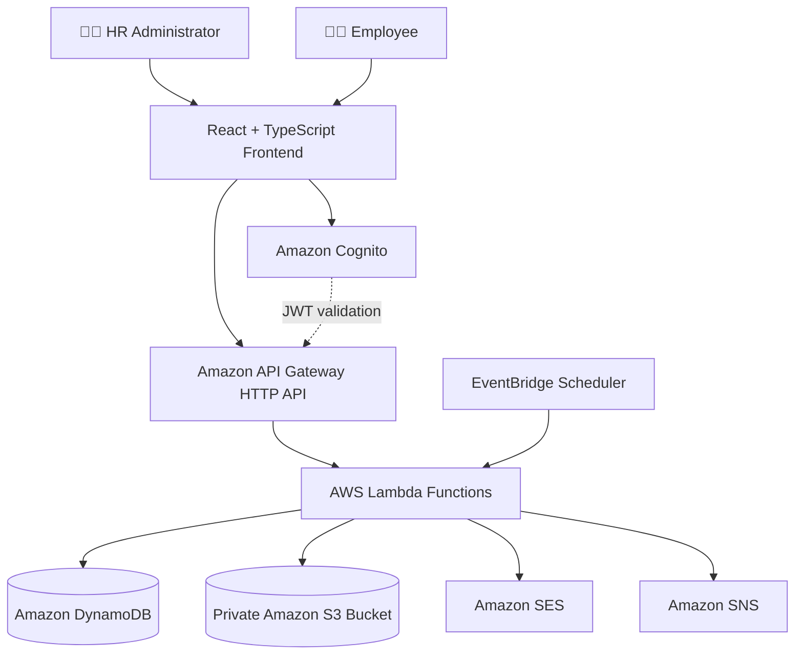
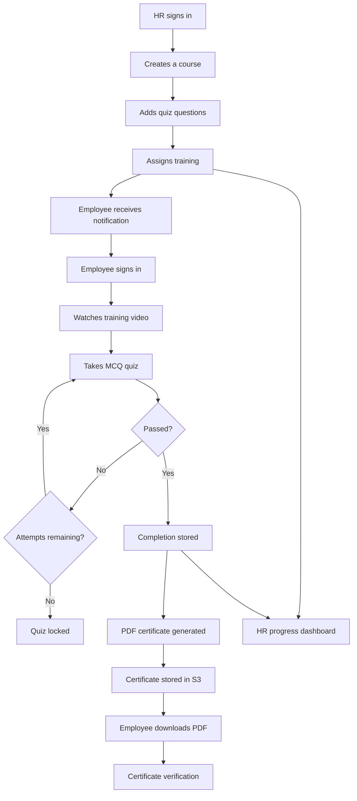
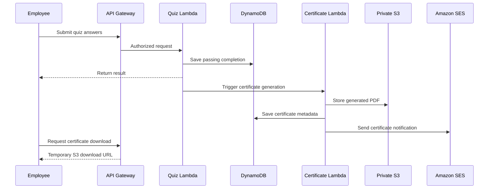
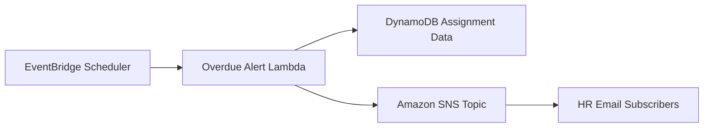

<div align="center">

# 🎓 SkillTrack
### Employee Learning & Skill Certification Tracker

**A serverless, cloud-native Learning Management System powered by AWS**

Manage training • Track skills • Conduct quizzes • Issue verifiable certificates


[Features](#-key-features) •
[Architecture](#-system-architecture) •
[Technology Stack](#-technology-stack) •
[API Reference](#-api-reference) •
[Setup](#-getting-started) •
[Demo](#-demonstration-guide)

</div>

---

## 📖 Project Overview

**SkillTrack** is a serverless Employee Learning and Skill Certification Tracker designed to simplify corporate employee training and competency monitoring.

Organizations often struggle with manually assigning learning material, tracking training deadlines, evaluating employees, and issuing certificates.

SkillTrack provides a centralized platform where HR administrators manage learning activities while employees complete assigned courses, take quizzes, and receive digital certificates.

The application integrates **React, TypeScript, AWS Lambda, Amazon API Gateway, Amazon Cognito, DynamoDB, S3, SES, SNS, and EventBridge Scheduler**.

### 🎯 Project Objectives

- Digitize employee training management.
- Provide role-based access for HR and employees.
- Automate course assignment and email notifications.
- Evaluate knowledge using secure multiple-choice quizzes.
- Enforce a maximum of three quiz attempts.
- Generate verifiable PDF certificates automatically.
- Track training progress and departmental skill completion.
- Identify overdue learning activities.
- Minimize infrastructure management through AWS serverless services.

---

## ✨ Key Features

### 👩‍💼 HR Administrator Portal

| Feature | Description |
|---|---|
| Secure authentication | Sign in with Amazon Cognito |
| Course creation | Create courses with descriptions, video URLs, and passing scores |
| Training assignment | Assign courses to employees individually or by eligible job role |
| Email notification | Notify employees through Amazon SES |
| Quiz management | Create multiple-choice questions from the HR interface |
| Progress monitoring | View assigned, passed, and overdue training |
| Department skill matrix | Monitor training completion percentages by department |
| Overdue alerts | Receive scheduled notifications through Amazon SNS |

### 👨‍💻 Employee Learning Portal

| Feature | Description |
|---|---|
| Personalized dashboard | View assigned training and deadlines |
| Video learning | Open course-related YouTube or Vimeo training videos |
| Online quizzes | Answer multiple-choice questions |
| Server-side grading | Receive scores calculated securely in AWS Lambda |
| Attempt restriction | Maximum three quiz attempts |
| Completion tracking | View training progress and results |
| PDF certificates | Download certificates for successfully completed courses |
| Certificate verification | Verify authenticity through a unique certificate ID |

---

## 🏗️ System Architecture

SkillTrack follows a serverless architecture with managed AWS services.



### How the system works

1. Users authenticate through **Amazon Cognito**.
2. React retrieves the authenticated user's access token.
3. Requests reach **Amazon API Gateway** with JWT authorization.
4. The corresponding **AWS Lambda** function processes the request.
5. Employee, course, assignment, quiz, and completion records are stored in **DynamoDB**.
6. Certificates are generated as PDF files and stored privately in **Amazon S3**.
7. **Amazon SES** handles course and certificate emails.
8. **EventBridge Scheduler** triggers periodic overdue checks that publish alerts through **Amazon SNS**.

---

## 🧰 Technology Stack

| Category | Technology | Purpose |
|---|---|---|
| Frontend | React | Interactive user interface |
| Programming language | TypeScript | Type-safe frontend development |
| Build tool | Vite | Local development and frontend builds |
| Authentication | Amazon Cognito | User authentication and role groups |
| API management | API Gateway HTTP API | REST-style API endpoints |
| Backend | AWS Lambda | Serverless business logic |
| Backend language | Python 3.14 | AWS Lambda implementations |
| Database | Amazon DynamoDB | NoSQL application records |
| Storage | Amazon S3 | Private PDF certificates |
| Email | Amazon SES | Assignment and certificate notifications |
| Notifications | Amazon SNS | HR overdue alerts |
| Scheduling | EventBridge Scheduler | Weekly overdue checks |
| Infrastructure | AWS SAM | Infrastructure as code |
| Source control | Git and GitHub | Version control |
| CI | GitHub Actions | Automated build and syntax checks |

**AWS deployment region:** `ap-south-1` (Mumbai)

---

## 🔄 End-to-End Application Workflow



---

## 🔐 Authentication and Authorization

SkillTrack supports two application roles.

| Role | Permissions |
|---|---|
| `HR_ADMIN` | Create courses, assign training, add questions, view HR dashboard |
| `EMPLOYEE` | View own assignments, take quizzes, download own certificates |

Amazon Cognito manages user sign-in and JWT access tokens.

API Gateway verifies access tokens for protected routes, while Lambda functions enforce role-specific permissions.

Employee-specific endpoints resolve employee identity from the authenticated Cognito subject rather than accepting an arbitrary employee ID from the browser.

<details>
<summary><strong>🔎 Why use JWT authentication?</strong></summary>

JWT authentication enables the backend to verify a user's identity without exposing AWS credentials in the React application.

It also separates authentication from business logic, supporting a cleaner and more maintainable system.

</details>

---

## 📚 Course and Assignment Management

HR administrators can create courses with:

- Unique course ID
- Title
- Description
- External training video URL
- Passing score
- Eligible employee roles

Supported training video links are restricted to approved HTTPS YouTube and Vimeo hosts.

After course creation, HR can assign the course using either an employee ID list or an eligible role.

Assignments contain:

| Field | Purpose |
|---|---|
| `employee_id` | Identifies the assigned employee |
| `course_id` | Identifies the course |
| `assigned_at` | Assignment timestamp |
| `due_date` | Training deadline |
| `status` | Assignment state |
| `email_status` | Email delivery request result |

Existing assignment records are not overwritten by duplicate requests.

---

## 📝 Quiz Management and Grading

SkillTrack implements multiple-choice assessment using DynamoDB and Lambda.

### Question Structure

Each question includes:

- Course ID
- Question ID
- Question text
- Four answer options
- SHA-256 hash of the correct answer

### Secure Answer Storage

The backend normalizes the correct answer before hashing:

```python
import hashlib

normalized = correct_answer.strip().casefold()

answer_hash = hashlib.sha256(
    normalized.encode("utf-8")
).hexdigest()
```

This prevents the employee-facing quiz endpoint from exposing plaintext correct answers.

**Note:** SHA-256 hashing helps hide answers from ordinary API responses, but it is not encryption and does not prevent guessing from a small known set of options. Backend access controls remain essential.

### Quiz Rules

| Rule | Implementation |
|---|---|
| Question fetching | Authenticated employee API |
| Correct answers | Not returned to employee |
| Grading | Performed server-side |
| Passing score | Configurable for each course |
| Attempt limit | Maximum three attempts |
| Passed quiz | Further submissions blocked |
| Completion records | Stored in DynamoDB |

<details>
<summary><strong>🛡️ Expand: Server-side attempt enforcement</strong></summary>

The attempt restriction is enforced by AWS Lambda and DynamoDB rather than relying only on the React interface.

This means hiding or modifying frontend controls cannot independently bypass the attempt limit.

Once a course is passed, repeat submissions are rejected.

</details>

---

## 🏅 Automated Certificate Generation

When an employee successfully passes a quiz, SkillTrack starts the certificate-generation workflow.

### Certificate Workflow



Each certificate includes employee and course information, a completion date, and a unique certificate identifier.

The PDF is stored using this S3 key structure:

```text
certificates/{employee_id}/{course_id}.pdf
```

The S3 bucket remains private.

### Secure Certificate Downloads

Certificate downloads require:

1. A valid employee Cognito access token.
2. A verified mapping to the signed-in employee.
3. A passing completion record for the requested course.
4. An existing certificate PDF in S3.

The API returns a **15-minute presigned S3 URL**.

### Public Certificate Verification

Certificates can be verified through:

```http
GET /verify/{cert_id}
```

This verification route is public, while the actual PDF download route requires employee authentication.

---

## 📊 HR Analytics and Skill Tracking

The HR dashboard aggregates application data to provide visibility into organizational learning progress.

### Dashboard Metrics

- Number of employees
- Number of courses
- Number of training assignments
- Completed training
- Overdue training

### Department Skill Matrix

The skill matrix summarizes learning completion percentages across departments.

This helps HR identify training coverage and gaps.

Overdue items are highlighted visually to prioritize attention.

---

## 📩 Weekly Overdue Training Alerts

SkillTrack uses EventBridge Scheduler to trigger an AWS Lambda overdue checker.

### Alert Process



The schedule is configured for **Monday at 9:00 AM, Asia/Kolkata**.

The alert Lambda has been manually tested. Scheduled execution depends on the next configured EventBridge trigger.

---

## 🗄️ DynamoDB Data Model

The application uses six DynamoDB tables.

| Table | Stores |
|---|---|
| `skilltrack-employees` | Employee profiles and Cognito mappings |
| `skilltrack-courses` | Training course information |
| `skilltrack-assignments` | Course assignments and deadlines |
| `skilltrack-quizzes` | Questions, options, and answer hashes |
| `skilltrack-completions` | Quiz scores, attempts, and completion status |
| `skilltrack-certificates` | Certificate identifiers and metadata |

DynamoDB supports a managed, serverless persistence layer without maintaining database servers.

---

## 🌐 API Reference

**Base URL**

```text
https://hmp7xht4bf.execute-api.ap-south-1.amazonaws.com
```

| Method | Endpoint | Access | Purpose |
|---|---|---|---|
| POST | `/courses` | HR Admin | Create training course |
| POST | `/assignments` | HR Admin | Assign training |
| POST | `/courses/{course_id}/questions` | HR Admin | Add MCQ question |
| GET | `/hr/dashboard` | HR Admin | Retrieve analytics |
| GET | `/me/assignments` | Employee | View assigned training |
| GET | `/courses/{course_id}/quiz` | Employee | Retrieve quiz questions |
| POST | `/courses/{course_id}/submit` | Employee | Grade submitted quiz |
| GET | `/me/certificates/{course_id}/download` | Employee | Obtain PDF download link |
| GET | `/verify/{cert_id}` | Public | Verify certificate |

<details>
<summary><strong>📤 Example: Create a Course</strong></summary>

```json
{
  "title": "AWS Security Fundamentals",
  "description": "Introduction to AWS security concepts",
  "external_video_url": "https://www.youtube.com/watch?v=VIDEO_ID",
  "passing_score": 80,
  "assigned_roles": [
    "Developer",
    "DevOps"
  ]
}
```

Example response:

```json
{
  "message": "Course created successfully",
  "course_id": "COURSE-EXAMPLE123",
  "title": "AWS Security Fundamentals"
}
```

The identifier above is illustrative.

</details>

<details>
<summary><strong>📤 Example: Assign Training</strong></summary>

```json
{
  "course_id": "COURSE001",
  "employee_ids": ["EMP001", "EMP005"],
  "due_date": "2026-11-15"
}
```

For role-based assignment, use `role` instead of `employee_ids`.

```json
{
  "course_id": "COURSE001",
  "role": "Developer",
  "due_date": "2026-11-15"
}
```

</details>

<details>
<summary><strong>📤 Example: Submit a Quiz</strong></summary>

```json
{
  "answers": [
    {
      "question_id": "Q001",
      "answer": "AWS IAM"
    },
    {
      "question_id": "Q002",
      "answer": "Amazon S3"
    }
  ]
}
```

The backend validates question IDs and selected answers before grading.

</details>

---

## 🗂️ Project Structure

```text
employee-learning-skill-tracker/
│
├── .github/
│   └── workflows/
│       └── ci.yml
│
├── backend/
│   ├── create_course/
│   ├── assign_course/
│   ├── add_quiz_questions/
│   ├── get_quiz/
│   ├── submit_quiz/
│   ├── my_assignments/
│   ├── hr_dashboard/
│   ├── generate_certificate/
│   ├── download_certificate/
│   ├── verify_certificate/
│   └── overdue_alerts/
│
├── frontend/
│   ├── public/
│   ├── src/
│   │   ├── App.tsx
│   │   ├── HrDashboard.tsx
│   │   ├── HrCourseManagement.tsx
│   │   ├── HrQuizManagement.tsx
│   │   ├── EmployeeDashboard.tsx
│   │   └── QuizPage.tsx
│   ├── package.json
│   └── vite.config.ts
│
├── scripts/
├── screenshots/
├── template.yaml
├── .gitignore
└── README.md
```

---

## 🚀 Getting Started

### Prerequisites

Install:

- Node.js and npm
- Python
- AWS CLI
- AWS SAM CLI
- Git

An AWS account is required to deploy the backend.

### 1. Clone the Repository

```bash
git clone https://github.com/SubhashiniRajamani/employee-learning-skill-tracker.git

cd employee-learning-skill-tracker
```

### 2. Install Frontend Dependencies

```bash
cd frontend
npm ci
```

### 3. Start the Development Server

```bash
npm run dev
```

Visit:

**http://localhost:5173/**

The frontend is currently configured to communicate with the project's existing AWS API Gateway endpoint. To deploy a separate environment, update the API endpoint and Cognito configuration for that environment.

### 4. Build the React Application

```bash
npm run build
```

### 5. Validate the Backend

From the project root:

```bash
python -m compileall -q backend
sam validate --lint
```

### 6. Build the AWS Infrastructure

```bash
sam build
```

### 7. Deploy AWS Resources

```bash
sam deploy --guided
```

Deployment requires AWS credentials, appropriate IAM permissions, and valid configuration values.

**Important:** The Cognito users, verified SES identities, email subscriptions, and demonstration dataset require separate configuration or provisioning. Deploying the SAM template alone does not recreate every piece of demo data.

---

## ⚙️ Continuous Integration with GitHub Actions

SkillTrack includes a GitHub Actions workflow at:

```text
.github/workflows/ci.yml
```

The workflow runs on pushes and pull requests.

### Automated Checks

| Job | Task |
|---|---|
| Frontend | Install dependencies and build React |
| Backend | Validate Python source syntax |

The workflow is intended for continuous integration and **does not automatically deploy to AWS**.

---

## 🧪 Testing and Validation

The application has been exercised using sample employees, courses, assignments, quizzes and certificates.

### Tested Workflows

| Test Scenario | Result |
|---|---|
| HR course creation | Completed |
| Assignment storage in DynamoDB | Completed |
| SES assignment notification | Completed |
| Quiz question creation | Completed |
| Employee quiz submission | Completed |
| Passing score calculation | Completed |
| Three-attempt restriction | Completed |
| Certificate PDF generation | Completed |
| Secure certificate download | Completed |
| Certificate verification | Completed |
| HR dashboard data loading | Completed |
| Manual overdue alert invocation | Completed |

**Note:** GitHub Actions results and the first automatically scheduled overdue-alert invocation should be checked independently.

---

## 🖼️ Application Screenshots

Screenshots can be added to the `screenshots/` directory.

<details>
<summary><strong>📸 View Screenshot Gallery</strong></summary>

After adding screenshots, embed them here using standard GitHub Markdown.

Suggested gallery:

| Screen | Screenshot |
|---|---|
| Login | `screenshots/01-login.png` |
| HR Dashboard | `screenshots/02-hr-dashboard.png` |
| Skill Matrix | `screenshots/03-skill-matrix.png` |
| Course Management | `screenshots/04-course-management.png` |
| Quiz Management | `screenshots/05-quiz-management.png` |
| Employee Dashboard | `screenshots/06-employee-dashboard.png` |
| Quiz Result | `screenshots/07-quiz-result.png` |
| PDF Certificate | `screenshots/08-certificate.png` |
| GitHub Actions | `screenshots/09-github-actions.png` |

Example image syntax:

```markdown

```

</details>

---

## 🎬 Demonstration Guide

Use the following sequence to demonstrate the project.

1. Open SkillTrack in the browser.
2. Sign in as an HR administrator.
3. Show the HR metrics and department skill matrix.
4. Create a course and configure its passing score.
5. Add multiple-choice quiz questions.
6. Assign the course to an eligible employee.
7. Sign out and sign in as that employee.
8. View the assigned course and complete its quiz.
9. Demonstrate a previously passed course and download its PDF certificate.
10. Open the public certificate verification endpoint.

For a reliable demo, prepare the intended question set before starting quiz attempts.

---

## 🛡️ Security Considerations

SkillTrack uses several security controls:

- Cognito-backed authentication
- JWT-protected application routes
- Role authorization for HR and employees
- Server-side quiz grading
- DynamoDB-enforced quiz attempt limits
- Restricted employee certificate access
- Private certificate storage
- Short-lived S3 download links
- IAM policies for AWS Lambda access
- Git ignore rules for local credentials and generated files

### Known Limitations

This implementation is a working demonstration rather than a fully hardened enterprise LMS.

Areas for future improvement include:

- Locking quiz content after attempts begin
- Stronger answer-protection strategies
- Automated end-to-end tests
- Database query optimization and pagination
- Public frontend hosting
- Improved audit trails and observability

---

## 🌱 Future Enhancements

- AWS Amplify Hosting for the frontend
- Course editing and lifecycle management
- Quiz versioning
- Richer analytics and reporting
- Searchable course catalog
- Completion export to CSV
- Automated deployment pipelines
- More comprehensive integration tests
- Enhanced accessibility and mobile usability

---

## 📌 Project Information

| Property | Value |
|---|---|
| Project | SkillTrack |
| Category | Employee Learning Management System |
| Architecture | AWS Serverless |
| Region | `ap-south-1` |
| Infrastructure Stack | `skilltrack-lms` |
| Frontend | React + TypeScript |
| Backend | Python + AWS Lambda |
| Source Repository | [GitHub](https://github.com/SubhashiniRajamani/employee-learning-skill-tracker) |
| Development Status | Core implementation complete |

---

## 👩‍💻 Author

**Subhashini Rajamani**

GitHub: [@SubhashiniRajamani](https://github.com/SubhashiniRajamani)

---

<div align="center">

### 🎓 SkillTrack

**Learn • Assess • Certify • Grow**

Built using React, Python, and AWS Serverless technologies.

[⬆ Back to Top](#-skilltrack)

</div>
