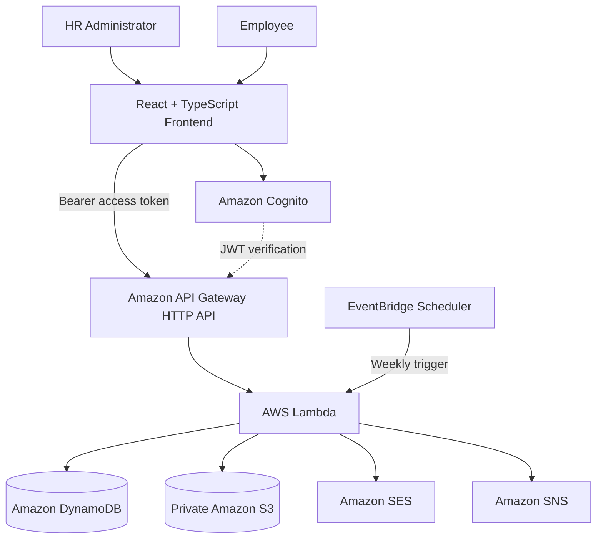
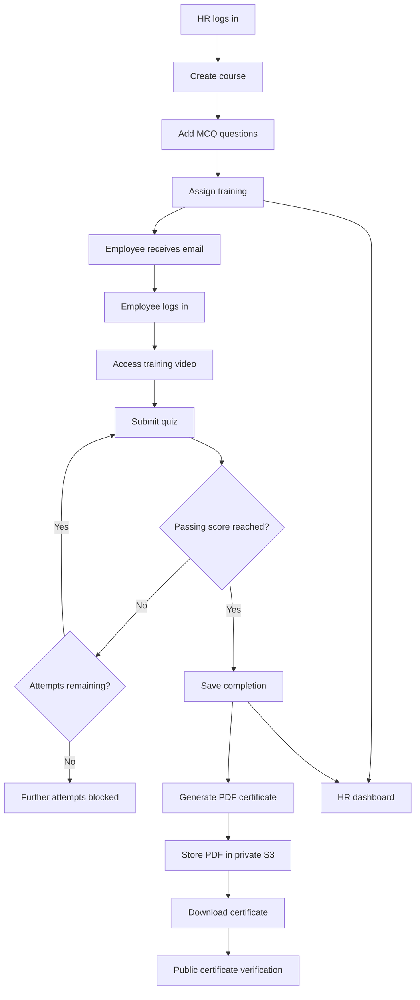
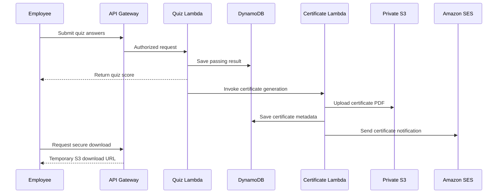
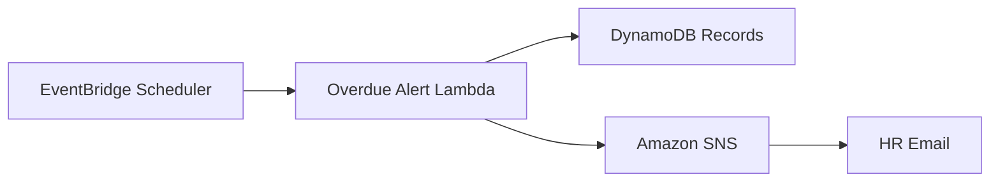

<div align="center">

# 🎓 SkillTrack
### Employee Learning & Skill Certification Tracker

**A cloud-native, serverless Learning Management System built on AWS**

Learn • Assess • Certify • Grow


[🚀 Features](#-key-features) •
[🏗 Architecture](#-system-architecture) •
[🛠 Tech Stack](#-technology-stack) •
[📸 Screenshots](#-application-screenshots) •
[🌐 APIs](#-api-reference) •
[⚙️ Setup](#️-getting-started)

</div>

---

## 📖 Project Overview

**SkillTrack** is a serverless employee learning and skill certification platform that digitizes corporate training.

The platform provides separate portals for HR administrators and employees. HR can create training courses, assign learning activities, manage assessments, monitor progress, and identify overdue training.

Employees can access assigned courses, learn through external training videos, complete MCQ assessments, and download PDF certificates after successfully passing.

The backend is implemented using AWS Lambda and Amazon API Gateway, with Amazon DynamoDB for application records, Amazon Cognito for authentication, and Amazon S3 for private certificate storage.

### 🎯 Project Objectives

- Centralize employee training management.
- Automate course assignments and notifications.
- Provide secure, role-based access.
- Evaluate employees using server-graded quizzes.
- Enforce quiz attempt limits.
- Automatically generate verifiable certificates.
- Measure department-level training completion.
- Identify overdue training and notify HR.
- Reduce infrastructure management using AWS serverless services.

---

## ✨ Key Features

### 👩‍💼 HR Administrator Portal

| Feature | Description |
|---|---|
| Authentication | Secure sign-in using Amazon Cognito |
| Course Creation | Create courses with titles, descriptions, video URLs, and passing scores |
| Course Assignment | Assign training by employee ID or eligible role |
| Email Notification | Send course assignment emails through Amazon SES |
| Quiz Management | Create MCQ questions through the HR interface |
| Progress Dashboard | View employees, courses, assignments, and completion metrics |
| Skill Matrix | Measure department-level mandatory training completion |
| Overdue Tracking | Identify overdue assignments |
| Weekly Alerts | Scheduled overdue notifications through Amazon SNS |

### 👨‍💻 Employee Learning Portal

| Feature | Description |
|---|---|
| Personal Dashboard | View assigned courses and deadlines |
| Learning Videos | Open course-related YouTube or Vimeo resources |
| MCQ Assessments | Take quizzes with four-option questions |
| Server-Side Grading | Receive scores calculated by AWS Lambda |
| Attempt Limits | Maximum of three attempts per course |
| Progress Tracking | Review completion status and quiz scores |
| PDF Certificates | Download certificates for passed courses |
| Public Verification | Validate certificates using a unique certificate ID |

---

## 🏗 System Architecture

SkillTrack follows an event-driven, serverless architecture.



### 🔍 Architecture Explanation

| AWS Service | Responsibility |
|---|---|
| Amazon Cognito | Authenticates HR administrators and employees |
| API Gateway | Exposes JWT-protected HTTP endpoints |
| AWS Lambda | Executes application business logic |
| DynamoDB | Stores employees, courses, quizzes, assignments, completions, and certificates |
| Amazon S3 | Stores generated PDF certificates privately |
| Amazon SES | Sends assignment and certificate notifications |
| Amazon SNS | Sends overdue-training alerts to subscribed HR recipients |
| EventBridge Scheduler | Triggers weekly overdue checks |
| AWS SAM | Defines and deploys serverless infrastructure |

---

## 🔄 Complete Learning Workflow



---

## 🛠 Technology Stack

| Layer | Technology |
|---|---|
| Frontend | React, TypeScript, Vite |
| Authentication | Amazon Cognito |
| HTTP API | Amazon API Gateway |
| Backend | AWS Lambda, Python 3.14 |
| Database | Amazon DynamoDB |
| Certificate Storage | Amazon S3 |
| PDF Generation | Python ReportLab |
| Email Delivery | Amazon SES |
| Notifications | Amazon SNS |
| Scheduling | Amazon EventBridge Scheduler |
| Infrastructure as Code | AWS SAM / CloudFormation |
| Version Control | Git and GitHub |
| Continuous Integration | GitHub Actions |

**AWS Region:** `ap-south-1` (Mumbai)

---

## 🔐 Authentication and Role-Based Authorization

SkillTrack provides two user roles:

| Role | Permissions |
|---|---|
| `HR_ADMIN` | Create courses, assign training, add quiz questions, view HR analytics |
| `EMPLOYEE` | View assigned courses, take quizzes, download personal certificates |

Amazon Cognito issues access tokens after successful authentication.

API Gateway validates JWTs for protected routes. Lambda functions additionally check the required Cognito group before processing sensitive operations.

Certificate download requests identify the employee from the verified Cognito subject rather than trusting an employee ID supplied by the browser.

<details>
<summary><strong>🔎 Why use Cognito and JWT authorization?</strong></summary>

Cognito provides managed authentication without requiring the application to store user passwords.

JWT authorization allows the API to verify authenticated requests. Backend role checks provide an additional authorization layer for HR-only and employee-specific operations.

</details>

---

## 📚 Course Creation and Assignment

HR administrators can create courses containing:

- A generated course ID
- Course title
- Description
- HTTPS YouTube or Vimeo training video
- Passing score
- Eligible employee roles

Training can be assigned to specific employee IDs or to employees matching an eligible role.

Each assignment includes a course ID, employee ID, assignment timestamp, due date, status, and email notification status.

Duplicate assignment requests do not overwrite existing assignment records.

---

## 📝 Secure Quiz Management

Quiz questions are stored in DynamoDB and delivered through protected employee endpoints.

Each question includes:

- Course ID
- Question ID
- Question text
- Four answer options
- Correct-answer hash

### Answer Hashing

Correct answers are normalized and hashed by the backend:

```python
import hashlib

normalized = correct_answer.strip().casefold()

answer_hash = hashlib.sha256(
    normalized.encode("utf-8")
).hexdigest()
```

The employee quiz API does not expose correct-answer hashes.

### Quiz Rules

| Rule | Implementation |
|---|---|
| Quiz access | Authenticated employee endpoint |
| Answer validation | Backend verifies submitted questions and choices |
| Grading | Performed by AWS Lambda |
| Passing threshold | Configurable for each course |
| Attempt limit | Three attempts |
| Passed quizzes | Further submissions blocked |
| Results | Stored in DynamoDB |

<details>
<summary><strong>🛡 Expand: Why enforce attempt limits on the backend?</strong></summary>

Frontend restrictions alone can be bypassed through direct HTTP requests.

SkillTrack enforces quiz attempt limits using Lambda and conditional DynamoDB updates, so the backend controls whether a submission is accepted.

Correct-answer hashing reduces accidental answer exposure, although SHA-256 does not prevent guessing from a small set of known options. Strong API authorization is still necessary.

</details>

---

## 🏅 Automated PDF Certificates

When an employee passes a quiz, the system records the completion and invokes a certificate-generation Lambda.



The PDF contains the employee's name, course, completion date, and unique certificate ID.

S3 object keys follow this structure:

```text
certificates/{employee_id}/{course_id}.pdf
```

### 🔒 Secure Download

The certificate download API checks:

1. The user has a valid employee access token.
2. The employee identity matches the Cognito subject.
3. The employee has passed the requested course.
4. The corresponding PDF exists in the private S3 bucket.

The API then generates a **15-minute presigned S3 URL**.

### ✅ Public Verification

Certificates can be checked using:

```http
GET /verify/{cert_id}
```

Verification is public. Downloading the actual PDF requires employee authentication.

---

## 📊 HR Dashboard and Skill Completion Matrix

The HR dashboard provides an overview of learning activity.

It displays:

- Total employees
- Total courses
- Total assignments
- Completed courses
- Overdue assignments
- Employee training status
- Department-level skill completion percentages

Overdue training is visually highlighted so HR can identify employees requiring follow-up.

---

## 📩 Scheduled Overdue Training Alerts

An EventBridge schedule invokes the overdue-training Lambda weekly.



**Scheduled frequency:** Every Monday at 9:00 AM, Asia/Kolkata.

The overdue-alert Lambda has been manually invoked successfully. The first scheduled execution should be verified separately after its scheduled time.

---

## 🗄 DynamoDB Tables

| Table | Purpose |
|---|---|
| `skilltrack-employees` | Employee profile and Cognito identity mapping |
| `skilltrack-courses` | Course metadata |
| `skilltrack-assignments` | Assignments and deadlines |
| `skilltrack-quizzes` | Quiz questions and answer hashes |
| `skilltrack-completions` | Quiz attempts, scores, and completion status |
| `skilltrack-certificates` | Certificate identifiers and metadata |

---

## 🌐 API Reference

**Base URL**

```text
https://hmp7xht4bf.execute-api.ap-south-1.amazonaws.com
```

| Method | Endpoint | Access | Description |
|---|---|---|---|
| POST | `/courses` | HR Admin | Create a course |
| POST | `/assignments` | HR Admin | Assign training |
| POST | `/courses/{course_id}/questions` | HR Admin | Add quiz question |
| GET | `/hr/dashboard` | HR Admin | Retrieve HR analytics |
| GET | `/me/assignments` | Employee | Retrieve assigned courses |
| GET | `/courses/{course_id}/quiz` | Employee | Retrieve MCQ questions |
| POST | `/courses/{course_id}/submit` | Employee | Submit and grade quiz |
| GET | `/me/certificates/{course_id}/download` | Employee | Request secure PDF link |
| GET | `/verify/{cert_id}` | Public | Verify certificate |

<details>
<summary><strong>📤 Example: Create Course</strong></summary>

```json
{
  "title": "AWS Cloud Security",
  "description": "Introduction to AWS cloud security principles",
  "external_video_url": "https://www.youtube.com/watch?v=VIDEO_ID",
  "passing_score": 80,
  "assigned_roles": ["Developer", "DevOps"]
}
```

</details>

<details>
<summary><strong>📤 Example: Assign Employees</strong></summary>

```json
{
  "course_id": "COURSE001",
  "employee_ids": ["EMP001", "EMP005"],
  "due_date": "2026-11-15"
}
```

</details>

<details>
<summary><strong>📤 Example: Submit Quiz</strong></summary>

```json
{
  "answers": [
    {
      "question_id": "Q001",
      "answer": "AWS IAM"
    }
  ]
}
```

</details>

---

## 📸 Application Screenshots

The following seven screenshots demonstrate the SkillTrack application and project repository.

<details open>
<summary><strong>🏠 1. SkillTrack Login Page</strong></summary>


**Description:** The SkillTrack entry page offers separate HR administrator and employee sign-in flows.

</details>

<details>
<summary><strong>📊 2. HR Dashboard & Skill Completion Matrix</strong></summary>


**Description:** HR training metrics, employee status, overdue tracking, and departmental skill completion percentages.

</details>

<details>
<summary><strong>📚 3. Course Management</strong></summary>


**Description:** HR course creation and training assignment forms.

</details>

<details>
<summary><strong>📝 4. Quiz Management</strong></summary>


**Description:** Multiple-choice question creation, answer options, and correct-answer selection.

</details>

<details>
<summary><strong>👨‍💻 5. Employee Dashboard & Quiz Results</strong></summary>


**Description:** Employee assignments, course progress, quiz results, and certificate actions.

</details>

<details>
<summary><strong>🐙 6. GitHub Project Repository</strong></summary>


**Description:** Project source code, frontend, backend, infrastructure and repository documentation.

</details>

<details>
<summary><strong>🏅 7. Generated PDF Certificate</strong></summary>


**Description:** Downloadable training completion certificate generated by AWS Lambda and stored privately in S3.

</details>

---

## 📁 Project Structure

```text
employee-learning-skill-tracker/
│
├── .github/
│   └── workflows/
│       └── ci.yml
│
├── backend/
│   ├── create_course/
│   ├── assign_course/
│   ├── add_quiz_questions/
│   ├── get_quiz/
│   ├── submit_quiz/
│   ├── my_assignments/
│   ├── hr_dashboard/
│   ├── generate_certificate/
│   ├── download_certificate/
│   ├── verify_certificate/
│   └── overdue_alerts/
│
├── frontend/
│   ├── public/
│   ├── src/
│   │   ├── App.tsx
│   │   ├── HrDashboard.tsx
│   │   ├── HrCourseManagement.tsx
│   │   ├── HrQuizManagement.tsx
│   │   ├── EmployeeDashboard.tsx
│   │   └── QuizPage.tsx
│   ├── package.json
│   └── vite.config.ts
│
├── scripts/
├── screenshots/
├── template.yaml
├── .gitignore
└── README.md
```

---

## ⚙️ Getting Started

### Prerequisites

- Node.js and npm
- Python
- AWS CLI
- AWS SAM CLI
- Git
- AWS account with permissions for the required services

### 1. Clone the Project

```bash
git clone https://github.com/SubhashiniRajamani/employee-learning-skill-tracker.git
cd employee-learning-skill-tracker
```

If the GitHub default branch differs, select the branch containing the latest application code.

### 2. Install Frontend Dependencies

```bash
cd frontend
npm ci
```

### 3. Run the React Frontend

```bash
npm run dev
```

Open:

**http://localhost:5173/**

The frontend currently uses the deployed SkillTrack AWS API and Cognito configuration. A separate deployment needs its own configuration values.

### 4. Build React

```bash
npm run build
```

### 5. Validate Python and SAM

From the project root:

```bash
python -m compileall -q backend
sam validate --lint
```

### 6. Deploy the Backend

```bash
sam build
sam deploy --guided
```

Deployment requires correctly configured AWS credentials and permissions.

Cognito test accounts, SES verification, SNS email subscriptions, and sample DynamoDB data must be provisioned separately where applicable.

---

## 🔁 GitHub Actions — Continuous Integration

GitHub Actions configuration:

```text
.github/workflows/ci.yml
```

The CI workflow performs:

| Job | Check |
|---|---|
| React Frontend Build | Install npm dependencies and compile the production frontend |
| Python Backend Checks | Validate Python source syntax |

The workflow runs on pushes and pull requests.

**Note:** CI does not automatically deploy the application to AWS. Check the repository's Actions tab for the latest run results.

[View GitHub Actions](https://github.com/SubhashiniRajamani/employee-learning-skill-tracker/actions)

---

## 🧪 Testing and Demonstration

The application has been exercised with a demo dataset containing five employees and multiple courses.

### Validated Scenarios

| Scenario | Status |
|---|---|
| HR course creation | Tested |
| Individual course assignment | Tested |
| SES assignment notification | Tested |
| HR quiz question creation | Tested |
| Employee quiz submission | Tested |
| Server-side scoring | Tested |
| Three-attempt restriction | Tested |
| PDF certificate generation | Tested |
| Secure certificate download | Tested |
| Certificate verification | Tested |
| HR dashboard display | Tested |
| Manual overdue alert invocation | Tested |
| First scheduled weekly alert | Pending scheduled execution |

### 🎬 Suggested Demo Walkthrough

1. Show the SkillTrack login page.
2. Sign in as an HR administrator.
3. Explain the HR Dashboard and Skill Completion Matrix.
4. Demonstrate course creation.
5. Show quiz question management.
6. Assign a course to an employee.
7. Sign in using the employee portal.
8. Show assigned courses and quiz functionality.
9. Open a passed course's certificate.
10. Demonstrate certificate verification.
11. Show the GitHub repository and CI workflow.

---

## 🛡️ Security and Limitations

### Security Controls

- Cognito-managed authentication
- JWT authorization at API Gateway
- Lambda role-based authorization checks
- Server-side grading
- DynamoDB-enforced quiz attempt limits
- Private S3 certificate storage
- Employee ownership checks for certificate downloads
- Short-lived S3 presigned URLs
- IAM permissions for AWS service access

### Known Limitations

This project is a functional demonstration, not a fully hardened enterprise LMS.

Improvements for production use include:

- Preventing quiz modification after employee attempts begin
- Stronger answer-security mechanisms
- Automated API integration tests
- Pagination and efficient DynamoDB access patterns
- Improved logging and monitoring
- Public frontend hosting
- Expanded accessibility testing

---

## 🚀 Future Enhancements

- AWS Amplify Hosting
- Automated deployment pipeline
- Course editing and archiving
- Versioned quizzes
- Searchable course catalog
- Exportable HR reports
- Enhanced employee skill analytics
- Larger-scale performance testing

---

## 📌 Project Details

| Property | Value |
|---|---|
| Project Name | SkillTrack |
| Domain | Employee Learning and Certification |
| Architecture | AWS Serverless |
| AWS Region | `ap-south-1` |
| Stack Name | `skilltrack-lms` |
| Frontend | React + TypeScript |
| Backend | Python + AWS Lambda |
| Database | DynamoDB |
| Certificate Storage | Amazon S3 |
| Repository | [GitHub](https://github.com/SubhashiniRajamani/employee-learning-skill-tracker) |
| Project Status | Core features implemented and tested |

---

## 👩‍💻 Author

**Subhashini Rajamani**

GitHub: [@SubhashiniRajamani](https://github.com/SubhashiniRajamani)

---

<div align="center">

### 🎓 SkillTrack

**Learn • Assess • Certify • Grow**

Built using React, TypeScript, Python, and AWS Serverless.

[⬆ Back to Top](#-skilltrack)

</div>
