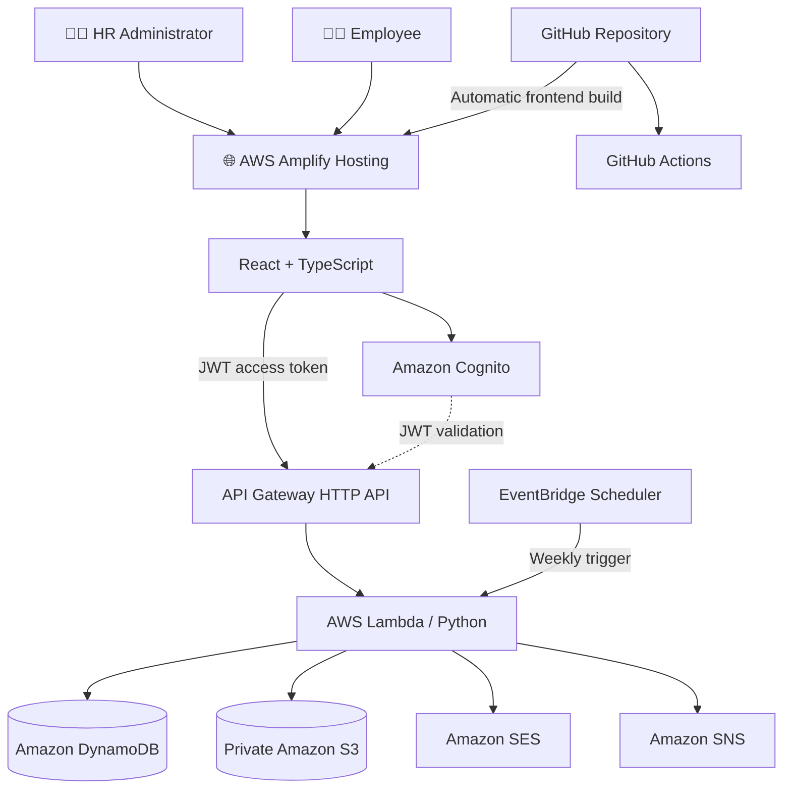
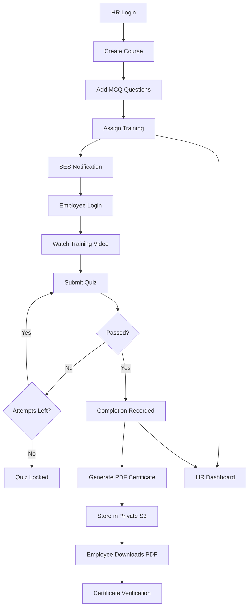
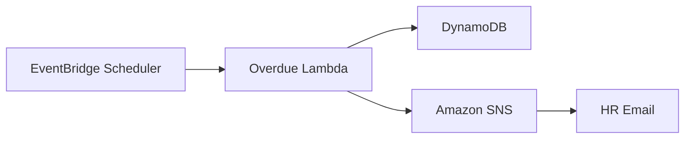

<div align="center">

# 🎓 SkillTrack
### Employee Learning & Skill Certification Tracker

**A cloud-native, serverless Learning Management System built using React, Python and AWS**

**Learn • Assess • Certify • Grow**

[](https://aws.amazon.com/)
[](https://react.dev/)
[](https://www.python.org/)
[](https://aws.amazon.com/dynamodb/)
[](https://aws.amazon.com/amplify/)
[](https://github.com/SubhashiniRajamani/employee-learning-skill-tracker/actions)

### 🌐 Live Application

[](https://master.da06iuy3xqk98.amplifyapp.com)

**🔗 https://master.da06iuy3xqk98.amplifyapp.com**

*Publicly hosted on AWS Amplify with HTTPS. Application dashboards require Amazon Cognito authentication.*

**[Features](#-key-features) · [Architecture](#-system-architecture) · [Screenshots](#-application-screenshots) · [APIs](#-api-reference) · [Installation](#-getting-started) · [Demo](#-demonstration-guide)**

</div>

---

## 📖 Project Overview

**SkillTrack** is a serverless employee learning, training management and skill certification platform.

It allows organizations to manage corporate learning through two dedicated portals:

- **HR Administrator Portal:** Create courses, assign training, add quizzes, monitor employees and track skills.
- **Employee Portal:** Access assigned training, take MCQ assessments, view results and download completion certificates.

The solution uses a React and TypeScript frontend publicly hosted on **AWS Amplify Hosting**, with a Python backend running on **AWS Lambda** behind **Amazon API Gateway**.

Amazon Cognito manages authentication, DynamoDB stores application records, Amazon S3 stores PDF certificates, and SES/SNS manage notifications.

### 🎯 Project Objectives

- Digitize corporate training management.
- Support HR and employee role-based access.
- Automate training assignments and email notifications.
- Evaluate employees with secure MCQ assessments.
- Enforce a maximum of three quiz attempts.
- Generate unique, verifiable PDF certificates.
- Monitor training progress and department-level skills.
- Notify HR about overdue learning activities.
- Use a scalable AWS serverless architecture.
- Provide a publicly accessible HTTPS frontend.

---

## ✨ Key Features

### 👩‍💼 HR Administrator Portal

| Feature | Description |
|---|---|
| Secure Login | Cognito authentication with HR authorization |
| Course Creation | Add course title, description, training video and passing score |
| Eligible Roles | Specify employee roles for each course |
| Course Assignment | Assign training to individual employees or by role |
| Email Notifications | Notify employees about assignments through Amazon SES |
| Quiz Authoring | Create four-option multiple-choice questions |
| HR Dashboard | View course assignments and completion metrics |
| Skill Matrix | Monitor department-level training completion |
| Overdue Tracking | Identify employees with overdue training |
| Scheduled Alerts | Weekly overdue checks using EventBridge and SNS |

### 👨‍💻 Employee Learning Portal

| Feature | Description |
|---|---|
| Secure Login | Cognito authentication with Employee authorization |
| Learning Dashboard | View assigned courses and due dates |
| Video Training | Open external learning videos |
| MCQ Assessments | Complete interactive quizzes |
| Automatic Grading | Receive scores computed by AWS Lambda |
| Attempt Restriction | Maximum three attempts, enforced server-side |
| Completion Tracking | View course status and quiz scores |
| PDF Certificates | Download generated completion certificates |
| Certificate Verification | Verify a certificate using its unique identifier |

---

## 🌍 Live Website & Deployment

### Public Frontend

**AWS Amplify Hosting URL:**

https://master.da06iuy3xqk98.amplifyapp.com

The frontend is deployed from this repository's `master` branch.

**Amplify build configuration:** `amplify.yml`

The React application is located in the `frontend/` directory.

### Existing AWS Backend

**AWS Region:** `ap-south-1` (Mumbai)

**AWS SAM Stack:** `skilltrack-lms`

**API Gateway Base URL:**

https://hmp7xht4bf.execute-api.ap-south-1.amazonaws.com

The publicly hosted frontend connects to the existing AWS API Gateway and Lambda backend.

**Deployment verification note:** The Amplify hosting URL has been created. API Gateway CORS must include the Amplify HTTPS origin, and public-site authentication should be tested separately before marking the live deployment fully verified.

---

## 🏗 System Architecture



### AWS Services and Responsibilities

| AWS Service | Purpose |
|---|---|
| Amplify Hosting | Publicly hosts the React website over HTTPS |
| Amazon Cognito | Authenticates employees and HR administrators |
| API Gateway | Exposes protected backend HTTP endpoints |
| AWS Lambda | Runs serverless application logic |
| DynamoDB | Stores employees, courses, assignments, quizzes and results |
| Amazon S3 | Stores private PDF certificates |
| Amazon SES | Sends course and certificate emails |
| Amazon SNS | Publishes overdue-training alerts |
| EventBridge Scheduler | Triggers scheduled overdue checks |
| AWS SAM | Defines backend infrastructure as code |

---

## 🧠 What Is AWS Lambda in SkillTrack?

AWS Lambda is the serverless compute service responsible for executing Python backend functions.

When users interact with SkillTrack, React makes an HTTP request to API Gateway. API Gateway verifies the request's JWT and invokes the appropriate Lambda function.

### Lambda Functions

| Function | Responsibility |
|---|---|
| `create_course` | Creates new training courses |
| `assign_course` | Assigns training and requests email notifications |
| `add_quiz_questions` | Saves new quiz questions and answer hashes |
| `get_quiz` | Retrieves employee-facing quiz questions |
| `submit_quiz` | Validates answers, grades quizzes and enforces attempt limits |
| `my_assignments` | Returns the signed-in employee's courses |
| `hr_dashboard` | Aggregates HR training metrics |
| `generate_certificate` | Creates and stores PDF certificates |
| `download_certificate` | Issues secure, temporary certificate download URLs |
| `verify_certificate` | Verifies certificate authenticity |
| `overdue_alerts` | Checks overdue training and publishes HR notifications |

Lambda eliminates the need to manage application servers directly.

---

## 🔄 End-to-End Learning Workflow



---

## 🛠 Technology Stack

| Layer | Technology |
|---|---|
| Frontend | React, TypeScript, Vite |
| Public Hosting | AWS Amplify Hosting |
| Authentication | Amazon Cognito |
| API | Amazon API Gateway HTTP API |
| Backend | AWS Lambda, Python 3.14 |
| Database | Amazon DynamoDB |
| File Storage | Amazon S3 |
| PDF Generation | ReportLab |
| Assignment Emails | Amazon SES |
| Overdue Notifications | Amazon SNS |
| Scheduler | Amazon EventBridge Scheduler |
| Infrastructure | AWS SAM / CloudFormation |
| Source Control | Git / GitHub |
| CI | GitHub Actions |

---

## 🔐 Authentication & Role-Based Security

SkillTrack supports two Cognito application groups.

| Group | Access |
|---|---|
| `HR_ADMIN` | Course creation, assignment, quiz management and analytics |
| `EMPLOYEE` | Learning dashboard, quiz submissions and personal certificates |

Protected routes validate Cognito access tokens through API Gateway.

Lambda functions perform additional role and identity checks.

The certificate download endpoint identifies employees through the authenticated Cognito subject, preventing users from requesting another employee's certificate by simply changing an ID.

<details>
<summary><strong>🔎 How JWT Authorization Works</strong></summary>

1. The user signs in with Amazon Cognito.
2. Cognito issues authentication tokens.
3. React sends the access token with protected API requests.
4. API Gateway validates the JWT.
5. Lambda verifies the required application role.
6. The authorized request is processed.

</details>

---

## 📚 Course Creation and Training Assignment

HR administrators create courses containing:

- Unique course ID
- Title and description
- HTTPS YouTube or Vimeo video URL
- Passing score
- Eligible employee roles

Training can be assigned either to specific employee IDs or by an eligible employee role.

Assignments store the employee, course, assignment date, deadline, status and email notification status.

Duplicate assignment attempts do not overwrite existing assignment records.

---

## 📝 Quiz Management and Secure Grading

Quiz questions are stored in DynamoDB with four possible answers.

The backend does not expose the correct-answer hash through the employee quiz endpoint.

### Answer Hashing

```python
import hashlib

normalized = correct_answer.strip().casefold()

answer_hash = hashlib.sha256(
    normalized.encode("utf-8")
).hexdigest()
```

### Quiz Rules

| Rule | Implementation |
|---|---|
| Quiz Access | Authenticated employee API |
| Question Options | Four options per question |
| Correct Answer | Stored as SHA-256 hash |
| Grading | Server-side Lambda |
| Passing Score | Defined per course |
| Maximum Attempts | Three |
| Passed Course | Further submissions blocked |
| Results | Stored in DynamoDB |

<details>
<summary><strong>🛡️ Why enforce grading on the backend?</strong></summary>

Frontend validation can be bypassed.

The backend verifies submitted questions and answer options, computes grades and uses conditional DynamoDB operations to enforce completion and attempt restrictions.

SHA-256 protects against direct plaintext answer exposure but is not encryption and cannot prevent guessing from a small known option set.

</details>

---

## 🏅 Automated PDF Certificate Generation

After a passing quiz result:

1. The completion is recorded in DynamoDB.
2. The certificate Lambda generates a PDF.
3. The PDF is uploaded to a private S3 bucket.
4. Certificate metadata is saved.
5. Amazon SES sends a certificate notification.
6. The employee can request a temporary download URL.
7. The unique certificate ID can be publicly verified.

### Certificate Storage

```text
certificates/{employee_id}/{course_id}.pdf
```

### Secure Download

The download Lambda confirms the signed-in employee owns a passing completion record before issuing a presigned S3 URL.

**Download link lifetime:** 15 minutes.

### Certificate Verification

```http
GET /verify/{cert_id}
```

Public verification does not expose the private PDF object itself.

---

## 📊 HR Analytics and Skill Matrix

The HR dashboard displays:

- Total employees
- Total courses
- Total assignments
- Completed training
- Overdue training
- Employee learning progress
- Department skill completion percentages

Overdue assignments are visually highlighted.

---

## 📩 Weekly Overdue Training Alerts

EventBridge Scheduler invokes the overdue-alert Lambda.

The Lambda evaluates training deadlines and sends overdue information through Amazon SNS.



**Schedule:** Monday, 9:00 AM, Asia/Kolkata.

The Lambda has been manually tested. The first automatically scheduled execution should be verified separately.

---

## 🗄 DynamoDB Tables

| Table | Stores |
|---|---|
| `skilltrack-employees` | Employee profiles and Cognito identity mappings |
| `skilltrack-courses` | Course information |
| `skilltrack-assignments` | Training assignments and deadlines |
| `skilltrack-quizzes` | Questions and answer hashes |
| `skilltrack-completions` | Attempts, scores and completion records |
| `skilltrack-certificates` | Certificate identifiers and metadata |

---

## 🌐 API Reference

**API Gateway Base URL**

```text
https://hmp7xht4bf.execute-api.ap-south-1.amazonaws.com
```

| Method | Endpoint | Access | Description |
|---|---|---|---|
| POST | `/courses` | HR Admin | Create course |
| POST | `/assignments` | HR Admin | Assign training |
| POST | `/courses/{course_id}/questions` | HR Admin | Create MCQ question |
| GET | `/hr/dashboard` | HR Admin | HR metrics and skill matrix |
| GET | `/me/assignments` | Employee | Employee dashboard data |
| GET | `/courses/{course_id}/quiz` | Employee | Fetch quiz questions |
| POST | `/courses/{course_id}/submit` | Employee | Grade quiz |
| GET | `/me/certificates/{course_id}/download` | Employee | Secure PDF link |
| GET | `/verify/{cert_id}` | Public | Certificate verification |

<details>
<summary><strong>📤 Example: Create Course</strong></summary>

```json
{
  "title": "AWS Cloud Security",
  "description": "Introduction to AWS cloud security concepts",
  "external_video_url": "https://www.youtube.com/watch?v=VIDEO_ID",
  "passing_score": 80,
  "assigned_roles": ["Developer", "DevOps"]
}
```

</details>

<details>
<summary><strong>📤 Example: Assign Training</strong></summary>

```json
{
  "course_id": "COURSE001",
  "employee_ids": ["EMP001", "EMP005"],
  "due_date": "2026-11-15"
}
```

</details>

<details>
<summary><strong>📤 Example: Quiz Submission</strong></summary>

```json
{
  "answers": [
    {
      "question_id": "Q001",
      "answer": "AWS IAM"
    }
  ]
}
```

</details>

---

## 📸 Application Screenshots

Seven screenshots demonstrate the completed core application.

<details open>
<summary><strong>🏠 1. SkillTrack Login Page</strong></summary>


**Description:** Role-based entry and authentication interface.

</details>

<details>
<summary><strong>📊 2. HR Dashboard & Skill Completion Matrix</strong></summary>


**Description:** HR statistics, employee progress, overdue assignments and department skill percentages.

</details>

<details>
<summary><strong>📚 3. Course Management</strong></summary>


**Description:** HR course creation and employee assignment forms.

</details>

<details>
<summary><strong>📝 4. Quiz Management</strong></summary>


**Description:** HR multiple-choice quiz authoring interface.

</details>

<details>
<summary><strong>👨‍💻 5. Employee Dashboard & Quiz Results</strong></summary>


**Description:** Assigned courses, quiz status, scores and certificate actions.

</details>

<details>
<summary><strong>🐙 6. GitHub Project Repository</strong></summary>


**Description:** Source code, backend, frontend, infrastructure and documentation.

</details>

<details>
<summary><strong>🏅 7. Generated PDF Certificate</strong></summary>


**Description:** Generated employee learning completion certificate.

</details>

---

## 📁 Project Structure

```text
employee-learning-skill-tracker/
│
├── .github/
│   └── workflows/
│       └── ci.yml
│
├── backend/
│   ├── create_course/
│   ├── assign_course/
│   ├── add_quiz_questions/
│   ├── get_quiz/
│   ├── submit_quiz/
│   ├── my_assignments/
│   ├── hr_dashboard/
│   ├── generate_certificate/
│   ├── download_certificate/
│   ├── verify_certificate/
│   └── overdue_alerts/
│
├── frontend/
│   ├── public/
│   ├── src/
│   │   ├── App.tsx
│   │   ├── HrDashboard.tsx
│   │   ├── HrCourseManagement.tsx
│   │   ├── HrQuizManagement.tsx
│   │   ├── EmployeeDashboard.tsx
│   │   └── QuizPage.tsx
│   └── package.json
│
├── screenshots/
│   └── Seven demonstration images
│
├── amplify.yml
├── template.yaml
├── .gitignore
└── README.md
```

---

## ⚙️ Getting Started

### Prerequisites

- Node.js and npm
- Python
- AWS CLI
- AWS SAM CLI
- Git
- AWS account

### 1. Clone the Repository

```bash
git clone https://github.com/SubhashiniRajamani/employee-learning-skill-tracker.git
cd employee-learning-skill-tracker
```

### 2. Install Frontend Dependencies

```bash
cd frontend
npm ci
```

### 3. Run Locally

```bash
npm run dev
```

Open:

http://localhost:5173/

The local frontend uses the configured AWS API endpoint and Cognito user pool.

### 4. Build the Frontend

```bash
npm run build
```

### 5. Validate the Backend

From the project root:

```bash
python -m compileall -q backend
sam validate --lint
```

### 6. Build and Deploy the Backend

```bash
sam build
sam deploy --guided
```

AWS credentials, permissions, SES verification, Cognito users, SNS subscriptions and demo data require their own configuration.

---

## ☁️ AWS Amplify Hosting

The React frontend is configured for AWS Amplify Hosting using the root-level `amplify.yml`.

<details>
<summary><strong>🚀 Expand: Amplify Deployment Process</strong></summary>

1. Push the project to GitHub.
2. Open AWS Amplify Console.
3. Connect the GitHub repository.
4. Select the `master` branch.
5. Configure the monorepo app root as `frontend`.
6. Use `npm ci` to install dependencies.
7. Use `npm run build` to build the website.
8. Publish the Vite `dist` output directory.
9. Configure the Amplify HTTPS domain in API Gateway CORS.
10. Verify authentication and protected API requests.

Public website:

https://master.da06iuy3xqk98.amplifyapp.com

</details>

### Amplify Build Settings

| Setting | Value |
|---|---|
| Repository | `SubhashiniRajamani/employee-learning-skill-tracker` |
| Branch | `master` |
| App Root | `frontend` |
| Install | `npm ci` |
| Build | `npm run build` |
| Output | `dist` |

---

## 🔁 Continuous Integration

GitHub Actions runs automated checks from:

```text
.github/workflows/ci.yml
```

| Job | Description |
|---|---|
| React Frontend Build | Installs dependencies and builds the frontend |
| Python Backend Checks | Validates Python backend syntax |

[View GitHub Actions](https://github.com/SubhashiniRajamani/employee-learning-skill-tracker/actions)

The CI workflow does not automatically deploy the AWS Lambda backend.

Amplify Hosting separately builds and deploys the frontend from the connected GitHub branch.

---

## 🧪 Testing and Validation

The core application has been tested using demonstration data.

| Test Scenario | Status |
|---|---|
| HR authentication | Tested |
| Employee authentication | Tested |
| Course creation | Tested |
| Employee assignment | Tested |
| SES assignment notification | Tested |
| Quiz question management | Tested |
| Quiz grading | Tested |
| Three-attempt limit | Tested |
| Certificate PDF generation | Tested |
| Certificate download | Tested |
| Certificate verification | Tested |
| HR dashboard | Tested |
| Manual overdue notification | Tested |
| GitHub Actions | Successful |
| Amplify frontend deployment | URL created |
| Public frontend end-to-end testing | Pending final verification |
| First scheduled weekly alert | Pending scheduled execution |

---

## 🎬 Demonstration Guide

1. Open the live SkillTrack website.
2. Sign in as HR Administrator.
3. Display the HR Dashboard.
4. Explain the Department Skill Completion Matrix.
5. Demonstrate course creation and assignment.
6. Show the MCQ question management interface.
7. Sign out and sign in as an employee.
8. Display assigned training and quiz results.
9. Download a previously generated PDF certificate.
10. Demonstrate certificate verification.
11. Show the project repository and GitHub Actions.

**Note:** Complete the public website CORS configuration and test authenticated API requests before conducting the live demonstration.

---

## 🛡️ Security

Security controls include:

- Cognito-managed authentication
- JWT authorization at API Gateway
- Backend role checks
- Server-side quiz grading
- DynamoDB-enforced attempt limits
- Private certificate S3 bucket
- Certificate ownership verification
- Short-lived download URLs
- Scoped Lambda IAM policies
- Git ignore rules for local credentials

### Known Limitations

- Quiz content should be locked or versioned after attempts begin.
- SHA-256 answer hashing is not equivalent to encryption.
- Additional automated integration tests are needed.
- DynamoDB access patterns can be optimized for larger datasets.
- Public-site end-to-end verification is required after CORS deployment.
- The first weekly scheduled alert has not yet been independently verified.

---

## 🚀 Future Enhancements

- Custom domain for the live website
- Quiz versioning and lifecycle controls
- Richer HR analytics and reporting
- CSV exports
- Automated backend deployment
- Advanced monitoring and audit logs
- Searchable training catalog
- Improved accessibility and responsive design

---

## 📌 Project Information

| Property | Value |
|---|---|
| Project | SkillTrack |
| Category | Employee Learning and Skill Certification |
| Architecture | AWS Serverless |
| Frontend | React + TypeScript |
| Public Hosting | AWS Amplify Hosting |
| Backend | Python + AWS Lambda |
| Database | DynamoDB |
| Storage | Private S3 |
| AWS Region | `ap-south-1` |
| SAM Stack | `skilltrack-lms` |
| GitHub | [Source Repository](https://github.com/SubhashiniRajamani/employee-learning-skill-tracker) |
| Website | [Live SkillTrack](https://master.da06iuy3xqk98.amplifyapp.com) |

---

## 👩‍💻 Author

**Subhashini Rajamani**

GitHub: [@SubhashiniRajamani](https://github.com/SubhashiniRajamani)

---

<div align="center">

### 🎓 SkillTrack

**Learn • Assess • Certify • Grow**

Built with React, TypeScript, Python and AWS Serverless.

[⬆ Back to Top](#-skilltrack)

</div>
